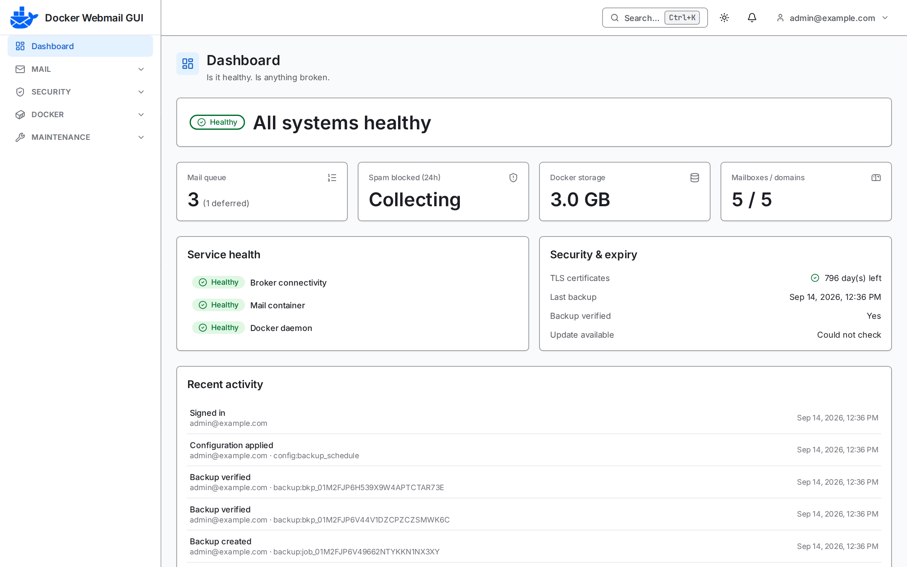
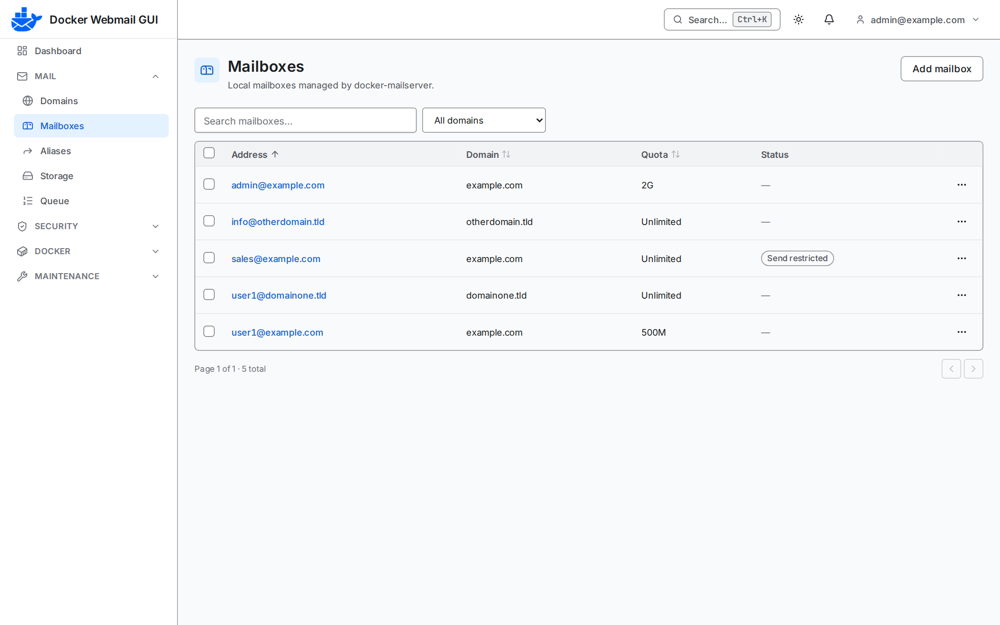
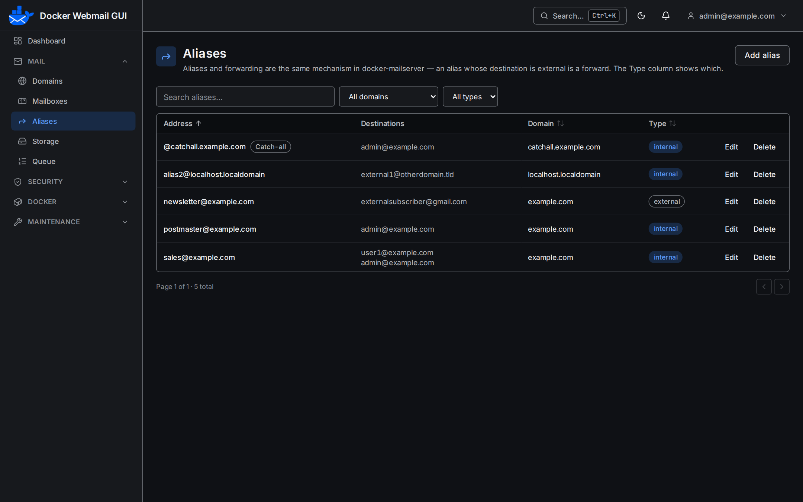
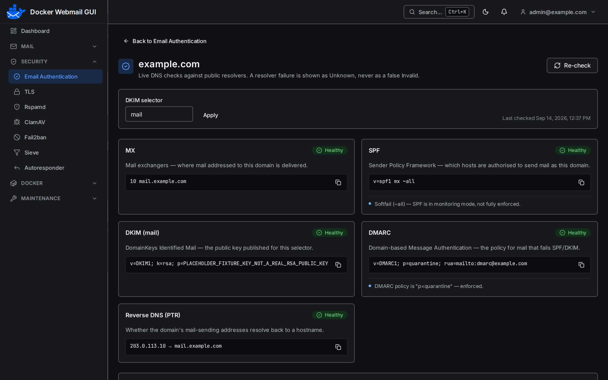
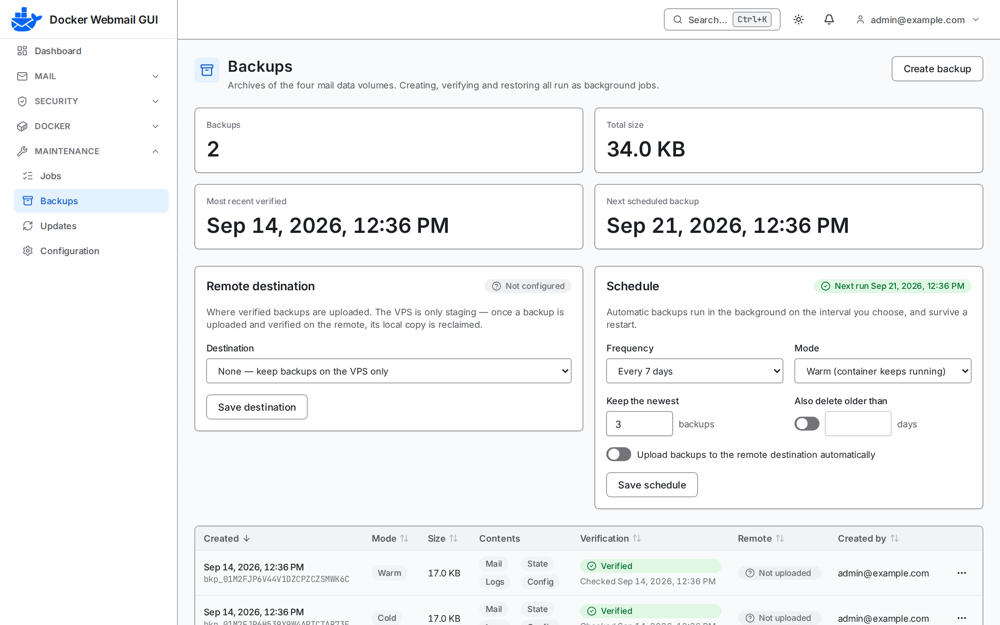
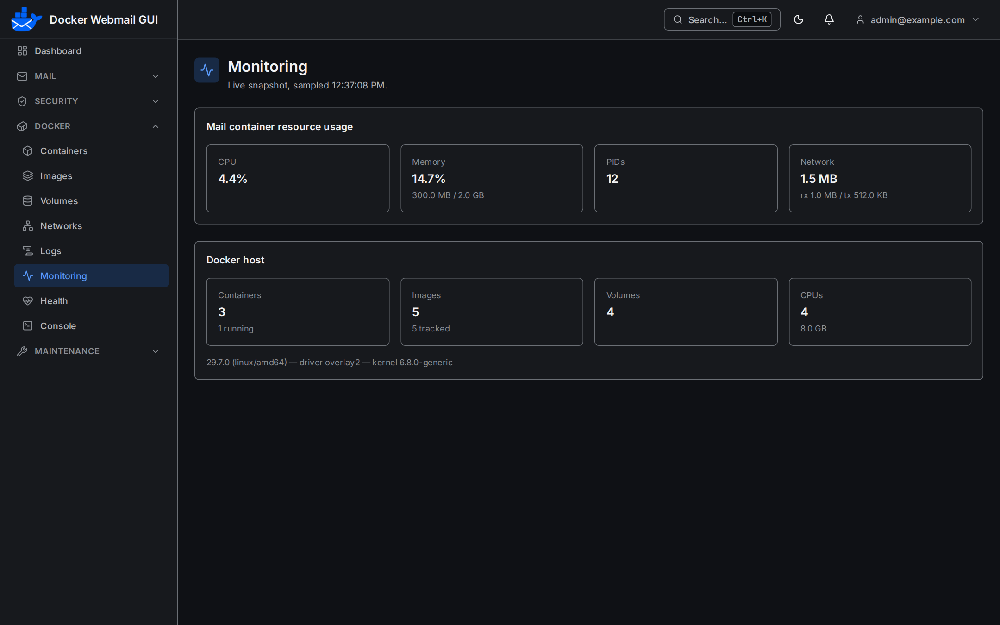
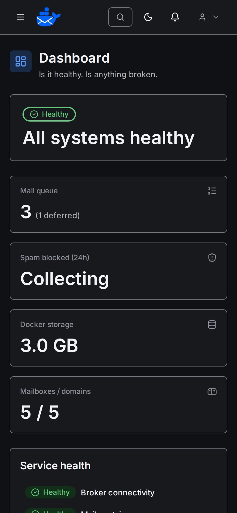
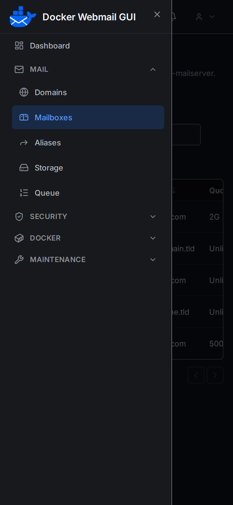

<p align="center">
  
</p>

# Docker Webmail GUI

A self-hosted web admin panel for [`docker-mailserver`](https://github.com/docker-mailserver/docker-mailserver), built so that a compromise of the web panel cannot become a compromise of your host.

[](https://github.com/ArvinRahnama/docker-webmail-gui/actions/workflows/ci.yml)
[](https://github.com/ArvinRahnama/docker-webmail-gui/actions/workflows/release.yml)
[](LICENSE)

Manage mailboxes, aliases, quotas, DKIM, Sieve rules, spam and antivirus settings, container health, logs and backups — from a browser, without handing that browser-facing process the keys to your machine.

<p align="center">
  <picture>
    <source media="(prefers-color-scheme: dark)" srcset="docs/screenshots/dashboard-dark.png" />
    
  </picture>
</p>

## Screenshots

<table>
  <tr>
    <td width="50%"><br /><sub><b>Mailboxes</b> — quotas, restrictions and bulk actions</sub></td>
    <td width="50%"><br /><sub><b>Aliases</b> — internal aliases, forwards and catch-alls</sub></td>
  </tr>
  <tr>
    <td width="50%"><br /><sub><b>Email authentication</b> — live MX, SPF, DKIM, DMARC and PTR checks</sub></td>
    <td width="50%"><br /><sub><b>Backups</b> — verified archives, S3/FTP remote and scheduling</sub></td>
  </tr>
  <tr>
    <td width="50%"><br /><sub><b>Monitoring</b> — container resources and Docker host</sub></td>
    <td width="50%">
      <p align="center">
        
        &nbsp;
        
      </p>
      <sub><b>On a phone</b> — every page is usable down to 320px, light or dark</sub>
    </td>
  </tr>
</table>

<sub>Screenshots use the built-in development fakes (`APP_MODE=development`) — example data, no real mail server.</sub>

## The problem this is built around

A mail-server panel needs Docker access. **Read/write access to the Docker socket is root on the host** — one `POST /containers/create` with a bind mount or `Privileged: true` ends the discussion. An internet-reachable web application is the worst possible holder of that capability.

So it doesn't hold it:

```
                    Browser (admin)
                          │  HTTPS · session cookie · CSRF
                          ▼
┌─────────────────────────────────────────────────────┐
│  apps/server — WEB TIER                             │
│  API · auth · sessions · SQLite · audit · jobs      │
│  Serves the SPA. Owns all business logic.           │
│  NO Docker socket. NO Docker verbs.                 │
└─────────────────────────────────────────────────────┘
                          │  named operations only, over an
                          │  internal-only network + shared secret
                          ▼
┌─────────────────────────────────────────────────────┐
│  apps/broker — PRIVILEGED TIER                      │
│  Tiny, rarely changed. Holds the Docker socket.     │
│  Allowlists operations AND target containers.       │
│  Never accepts a container spec from the web tier.  │
└─────────────────────────────────────────────────────┘
                          │  Docker Engine API (unix socket)
                          ▼
              Docker daemon → docker-mailserver
```

The web tier speaks a closed vocabulary of **47 named intents** — `container.restart`, `dms.email.add`, `logs.file`. **There is no field in that protocol that can carry a path, an argv array, a bind mount, a capability, or a container specification**, and a test fails the build if one ever appears. Full remote code execution in the web tier yields the broker's allowlist and nothing more.

That is the whole design. [`docs/security-model.md`](docs/security-model.md) is the operator's version — what the boundary protects you from, and just as importantly what it does not.

## Status

**v1.3.0 — production release.** Every feature milestone is built, the images are published, and CI runs a real install → healthy → uninstall cycle — plus a real-daemon panel self-update — on every push.

Verified: the full unit and real-browser end-to-end suites pass, including a CSP and accessibility sweep against the built SPA; both images built and run; the privilege boundary checked from inside the running containers; a real-daemon self-update that recreates both panel containers and comes back healthy; and the panel driving a live `docker-mailserver`, reading a real account and creating one that appears in the mail server's own config with a maildir on disk.

**Three things are not proven, and you should know them before trusting this with anything important:**

1. **No mail has ever flowed through a server this panel manages.** Every figure was read from a mail server with two accounts and no delivered messages, so quota usage, spam and virus counters, and Fail2ban bans are all unexercised.
2. **The packaged container has never been driven through a browser.** The end-to-end suite runs against development harnesses; the published image was exercised over HTTP.
3. **ClamAV reports `Unknown` on a stock `docker-mailserver` image**, because reaching clamd needs `socat`, which that image does not install. This is the design failing honestly rather than guessing, but it does mean live ClamAV status is unavailable by default.

As of `1.0.0` this project follows Semantic Versioning: incompatible changes to the configuration format or database schema bump the major version and are called out in [`CHANGELOG.md`](CHANGELOG.md). [`AUDIT.md`](AUDIT.md) is the full account of what is proven, what is merely asserted, and what a reader may not conclude.

## Quick start

Requires a Linux host with Docker Engine and the Compose v2 plugin. Nothing is built locally — this pulls the published images.

```sh
mkdir -p docker-webmail-gui/docker && cd docker-webmail-gui

curl -fsSL -o docker/compose.yaml \
  https://raw.githubusercontent.com/ArvinRahnama/docker-webmail-gui/v1.3.0/docker/compose.yaml

cat > .env <<EOF
DWG_VERSION=1.3.0
PORT=3000
COOKIE_SECRET=$(openssl rand -hex 32)
BROKER_SHARED_SECRET=$(openssl rand -hex 32)
DOCKER_GID=$(stat -c '%g' /var/run/docker.sock)
BOOTSTRAP_ADMIN_EMAIL=admin@example.com
BOOTSTRAP_ADMIN_PASSWORD=$(openssl rand -hex 16)
EOF
chmod 600 .env

docker compose -f docker/compose.yaml --env-file .env up -d
```

Then open `http://127.0.0.1:3000`, sign in with the address and password from `.env`, and change the password — the first login requires it. Clear the two `BOOTSTRAP_ADMIN_*` lines afterwards.

> **Reaching it from another machine?** The session cookie is sent with `Secure`, and browsers refuse to store that over plain `http://` on anything but `localhost`. Terminate TLS in front of the panel (and set `BIND_ADDRESS=127.0.0.1` so the port is only for your proxy), or set `COOKIE_SECURE=false` for a trusted LAN. Without one of those, login silently does nothing. See [`docs/configuration.md`](docs/configuration.md).

`docker-mailserver` is **not** deployed by this project — bring your own, on the same Docker host, and point `DMS_CONTAINER_NAME` at it.

**Installing from a source checkout instead**, with secret generation, health checks and a privilege-boundary assertion done for you:

```sh
git clone --branch v1.3.0 https://github.com/ArvinRahnama/docker-webmail-gui.git
cd docker-webmail-gui
DWG_IMAGE_MODE=pull ./installer/install.sh    # or omit to build from source
```

Re-running the installer is safe: it upgrades in place, preserves hand-edited settings, and never regenerates a secret. Uninstall with `./installer/uninstall.sh` — which never removes a mail volume under any flag. Full detail in [`docs/docker.md`](docs/docker.md).

## What it does — and honestly does not

The guiding rule: **a feature is real, explicitly unsupported, or absent.** No control ships that the backend cannot perform, and nothing renders a number it had to invent.

| Area                                                        | What you get                                                                                                                                                                                                                                                                                                                                                   |
| ----------------------------------------------------------- | -------------------------------------------------------------------------------------------------------------------------------------------------------------------------------------------------------------------------------------------------------------------------------------------------------------------------------------------------------------- |
| **Mailboxes, aliases, quotas, passwords**                   | Full. Deleting an account always requires an explicit choice about whether its mail dies with it.                                                                                                                                                                                                                                                              |
| **Domains**                                                 | Derived from addresses. `docker-mailserver` has no domain concept, so there is no create or delete — the page offers "Add mailbox".                                                                                                                                                                                                                            |
| **DNS, DKIM, SPF, DMARC**                                   | Full diagnostics. A resolver failure renders as grey `Unknown`, never as a red `Invalid`.                                                                                                                                                                                                                                                                      |
| **Rspamd, ClamAV, Fail2ban**                                | Status, statistics, thresholds, learn spam/ham, unban. Rspamd config editing is refused: its config embeds Lua and its maps fetch URLs.                                                                                                                                                                                                                        |
| **Sieve and autoresponders**                                | Full, with real start/end dates generated server-side. Scripts invoking external programs are rejected.                                                                                                                                                                                                                                                        |
| **Containers, images, volumes, networks, logs, monitoring** | Read plus start/stop/restart. No create, no remove, no pull — the broker has no such operation, deliberately.                                                                                                                                                                                                                                                  |
| **Backups and restore**                                     | Full, and the highest-risk feature here: restore needs the container stopped, a typed confirmation, and either a verified backup or an explicit acknowledgement. Backups can run on a schedule and optionally upload to S3 or FTP/FTPS, with automatic remote retention; secrets are masked, audited on reveal, and proven never to leak in logs or responses. |
| **Updates**                                                 | Checking is real. **Applying is refused**, names the missing Docker operation, and audits the refusal every time.                                                                                                                                                                                                                                              |
| **Terminal**                                                | A fixed set of zero-argument diagnostic commands, off by default. Never a shell.                                                                                                                                                                                                                                                                               |
| **MCP connections**                                         | On by default (switch it off on the Configuration page); inert until a postmaster turns the service on. Postmaster-issued, per-mailbox connections for ChatGPT and other MCP clients (OAuth): read and search, confirmed send, move to Trash. Runs inside the server container, with no Docker access — [`docs/mcp-integration.md`](docs/mcp-integration.md).  |

[`FEATURE_MATRIX.md`](FEATURE_MATRIX.md) is the authoritative row-by-row version, including everything deliberately unsupported and why.

## Documentation

- [`docs/security-model.md`](docs/security-model.md) — **read before installing.** What you are accepting.
- [`docs/docker.md`](docs/docker.md) — deployment, hardening, uninstall, and what is verified where.
- [`docs/configuration.md`](docs/configuration.md) — the settings that need a decision. [`.env.example`](.env.example) is the full reference.
- [`docs/operations.md`](docs/operations.md) — what each area of the panel does.
- [`docs/backup-restore.md`](docs/backup-restore.md) — archive format and the by-hand restore path.
- [`docs/troubleshooting.md`](docs/troubleshooting.md) — symptoms, causes, and how to read `Unknown`.
- [`docs/mcp-integration.md`](docs/mcp-integration.md) — the MCP service: postmaster-issued mailbox connections for ChatGPT and other MCP clients.
- [`AUDIT.md`](AUDIT.md) · [`SECURITY.md`](SECURITY.md) · [`ARCHITECTURE.md`](ARCHITECTURE.md) · [`CHANGELOG.md`](CHANGELOG.md)

## Development

Node 24 and npm workspaces. No Docker daemon or mail server needed — every driver has a fixture-backed fake, and that is the development default.

```sh
npm install
npm run dev            # server, broker and SPA
npm run check          # deps, audit, lint, format, typecheck, tests
npm run test:e2e       # Playwright
```

See [`CONTRIBUTING.md`](CONTRIBUTING.md), and [`docs/AGENT_BRIEF.md`](docs/AGENT_BRIEF.md) for the condensed working context.

## Security

Found a vulnerability? See [`SECURITY.md`](SECURITY.md) Part 1 — please use private disclosure rather than a public issue.

## License

Apache-2.0. See [`LICENSE`](LICENSE) and [`NOTICE`](NOTICE).
